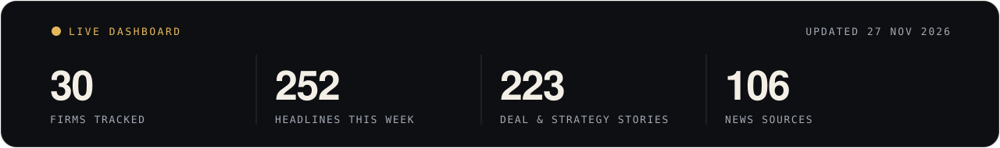

  
  
  
  

<b>Track the world's leading law firms — their deals, practices, insights and opportunities — in one place.</b> 
30 top firms across the USA, UK and India · deal and strategy headlines refreshed every morning · built for law students, lawyers and legal-tech professionals.

  <a href="NEWS.md"><b>📰 Today's digest</b></a> ·
  <a href="#-the-radar">🗂️ All firms</a> ·
  <a href="#-by-specialism">🎯 By specialism</a> ·
  <a href="#-free-legal-research-toolkit">⚖️ Free legal research toolkit</a> ·
  <a href="#-for-law-students">🎓 For law students</a>

## 🔥 Today's highlights

The newest headline for the ten most recently covered firm entries — refreshed every morning (IST).

| Date | Firm | Headline |
|:--|:--|:--|
| 2026-11-24 | [**Latham & Watkins**](firms/latham-watkins.md) | [Latham & Watkins Advises the Owners on the Sale of Ziehl-Abegg to ABB](https://news.google.com/rss/articles/CBMilwFBVV95cUxQR0UxMHRYc0hiZi1ic2pYbUdrNXAtejNUYU9XV09zWEo0Tk9KZzh4SUEzVDBjMHhOLXNEY0tNakNURllVQURmRWNyNUM5akpWRFBiVElJVTdXOGtpd2FrNmpVcmVwbFBybGlrQ0gySVMtWHVnUGl2UWRXMHNxeGNzVDhYM0pOUFZlSzJKaC1rZjJNVHczT3cw?oc=5) |
| 2026-11-24 | [**Cravath, Swaine & Moore**](firms/cravath-swaine-moore.md) | [Cravath Advises Sanofi On $41B Acquisition of US Drugmaker](https://news.google.com/rss/articles/CBMingFBVV95cUxQSldzWjZaajA1LWlDa3dXaU9MZlR6d3hvU1hfTDdMRnVSRVI0cFpISThmbE83WnpXTG9JdmZzNTM5RmZYai1zNUpuUzl2c1Bpb0pzVzVweVhyeVpKQkxrXzdDNnU5MlZnQ05YODFRYlNFUnl1YXQ4MVBYMURPQjBDeEdCS0k2ZEdpWm1qLTVfUi1udUNFLXpieVVwWTVFZ9IBVkFVX3lxTE53eG9McDZ1X0FjX2RBMmlkcHhzOHRQWUVSMGF4X2pvUjBHZU1KRHF1Wnd3T3hNZ2VsZXZwV05SeDkxc1ViOHdKWkdMemVMOWRjaGV0ODVB?oc=5) |
| 2026-11-24 | [**Sullivan & Cromwell**](firms/sullivan-cromwell.md) | [Sullivan & Cromwell Breaks with Tradition: Frankfurt’s Carsten Berrar Set to Lead the New York Firm](https://news.google.com/rss/articles/CBMi3AFBVV95cUxOMU1OQnFVN3lqRGREbmI5aVBDbHNzaGdLMncxWTREVVN1WGRBLTVKMzFGdnVKSVBQOWNNZHVya0FhWmlVcHBDbV9HMHlVS2VJSjNpNHB2Q3BnQ3NmNmk0WERSek5TeXB6NVJOV3VUWHdibHJKcGg2cjdTNXZOUl9rUTlmcWdmYXlxMjViVUNBVnVyZ2Q3M2pBN0dJaGNucl9EMkFFVkxfdlJFU1A3TmRUN1d4V2ZxT21OdlJ5UmZhYVlsak84bmJ6cmJMSTNpM3hKUDdZRW5BSXBXWnl4?oc=5) |
| 2026-11-24 | [**White & Case**](firms/white-case.md) | [White & Case latest firm to confirm Weil partner hires](https://news.google.com/rss/articles/CBMimAFBVV95cUxQSXJIVXNnYW1KMFBDS3FhaXotd3VjaUJ1bU15a0ZqV1JUUE5XdkNXSTFHR256R1gycE9FX0EzdEh1eWtaWmE0NkZVa3VmV0RrR0o5QzJwNF9PVkRrbk5wOS1LNXlPRnptR0VCRnFWbzJwa0Y4c1lsLTZ4Q013alBVcXVRdXQydkVsUF9FN25UQl9tdmwxNXlKNQ?oc=5) |
| 2026-11-24 | [**Clifford Chance**](firms/clifford-chance.md) | [Clifford Chance advises Permira on its Sale of Quotient Sciences to IQVIA](https://news.google.com/rss/articles/CBMinwFBVV95cUxNR01pQW5IMlpVLVNZVGhrcVpaUmxkWm42azgtR3djLTR0d1VzM0txbnNSOUw4NDlBUS1lTEVHVWowblFCWlE0cEtjaEM5Si1wQkhWUFkxelpQTnRFeVlyMGRuanNYbUpJVnExTzkxaHdEMlQwVGRFUVdueGlUMnF2UHBmWW5PNm44cWZaLWRZajRZWnk2dTd4ZmJqdVJUR28?oc=5) |
| 2026-11-24 | [**Linklaters**](firms/linklaters.md) | [Linklaters advises on Aegis Logistics’ INR 35bn qualified institutional placement of shares in India](https://news.google.com/rss/articles/CBMiwgFBVV95cUxPZmdmNWRyc0xOcXhkeUN6WDB6WUJQdlJMREpUdHBHNU9yVnJhUnFrY29CWXdsaE9pdUoySTVfeUEzLVpKV1FHeDVLeEdIRmlRUEpfZ3V3T1E2MmdDTHpyS2IxSEl1ZVAzd0NfMFBkcVAxaF9WMnp0SjdMUnNDbE1pYTktbDVaYlk5NlpjbnRma3ByV0FUdkxFNG9wY3pEYVNOZ0R2emFyWHFxV1k5TnZ3ZktMeGJROVlYakVSNVZmTjRjdw?oc=5) |
| 2026-11-24 | [**Freshfields**](firms/freshfields.md) | [Freshfields Adds Weil Litigation Partner Duo in US](https://news.google.com/rss/articles/CBMipwFBVV95cUxQRm5WMVZ4NW1rRHdiZnJUb3JoTlBFVkJVMWE1SU0yVkY1cWFLa1hRRjZ6X1pTX0lLMFRBTEZrMzhsR3BoT1hOQlI3NVdjcHNOcmNPbkt4azRMLTFZOXppcE9KbEZaZXhoZUhLcWNubm1LLV9rTXk3SE0zdWVGb0NTTHVKakQ4dDl4bEZDdmRxbUR4bXVhVWJzZFVrVnk0Q0tha0t5SGIySQ?oc=5) |
| 2026-11-24 | [**A&O Shearman**](firms/a-o-shearman.md) | [A&O Shearman accelerator member Reversa raises €750k in pre-seed funding](https://news.google.com/rss/articles/CBMivAFBVV95cUxQLWhBR2RFc0Q2VEFxRlJ2YXctTVZzS1ZxaGZvb3JramVfVjJHS1FhSnVOa3JuYm9xWDhSNm1Ecl91WG52Tm9xcXNOWGRhVTh6eHkyWXBjZ0xnWnFuZHIwYk9SM0R1YTBMQUhBZkU1SS1xdURqTGJjQlJKTWZITDVrOVZRVWJNQktzT3RwLUY1aC1zS0ZCYkRJNzZJeTBuZXhNTnhrbk1WUXV4ZU83ZUtnQ20zNThmMWEtRjhGSg?oc=5) |
| 2026-11-24 | [**Slaughter and May**](firms/slaughter-and-may.md) | [More details emerge in dispute between Labour MP and xAI over Grok deepfakes (via Passle)](https://news.google.com/rss/articles/CBMiwwFBVV95cUxQRncwMXV1c1o2amM0bmR4M1lFMDA1eG5aUnhFaE53dzhFTll6cWNBc0htSi1IdjFiWnViVTRYRl9mNlkzaDBudmJNVXB4dlZaWDBSVnNEaEgxanV0ZU1fZ2twY2Y1ZmlGTHFCRDQ1Z0NIWjA0Si1aWUlRdG1RNU1sYVdmdHRMdERmMjF2MS1WZjcwaExlajd4cC15SjJkVFo5WVZYNTdrQlkwRTRVaFVDRUUxM2hUcDNyRE5qaDhuN3M2LUU?oc=5) |
| 2026-11-24 | [**Ashurst**](firms/ashurst.md) | [Financial Services Snapshots](https://news.google.com/rss/articles/CBMimAFBVV95cUxOWlhWLWJScTl1UUZGaFhWX1V4RElJQnZiV0dGM1ZkNHFfc2otVnhjZEhOVzQ1U2ZQaVR1Y3FnOHo4TW43MEdvRlllb3ZNZ2FvR3BvVVd5TTRnNzN4VmxvNlhZd0ZpQURRM05GRWk4bnVqN0F3c2ZQdlEyRjUzQ0JZM2hXUlEzQnFHYWxBWDM2LWpTZXdZWE1FUA?oc=5) |

<a href="NEWS.md"><b>Full daily digest →</b></a>

---

## 🧭 What each firm profile gives you

| Section | What you get |
|:--|:--|
| 🔗 **Quick links** | Website, insights and publications, internship and graduate pages, Chambers ranking, Google News and a one-click alert |
| 🧰 **Free resources** | Free guides, newsletters and tools the firm publishes |
| 🔭 **Deals & strategy** | Last 30 days of headlines on deals advised, mergers, new offices, lateral hires and practice launches |
| 📰 **Latest news** | The past week's coverage, newest first |

---

## 🗂️ The radar

### 🇺🇸 USA · Law Firms

| Firm | Focus | Profile | Headlines this week |
|:--|:--|:--|--:|
| [**Kirkland & Ellis**](https://www.kirkland.com) | Corporate, private equity | [Open →](firms/kirkland-ellis.md) | 10 |
| [**Latham & Watkins**](https://www.lw.com) | Corporate, litigation | [Open →](firms/latham-watkins.md) | 10 |
| [**Skadden**](https://www.skadden.com) | M&A, securities | [Open →](firms/skadden.md) | 10 |
| [**Cravath, Swaine & Moore**](https://www.cravath.com) | Corporate law, litigation | [Open →](firms/cravath-swaine-moore.md) | 10 |
| [**Sullivan & Cromwell**](https://www.sullcrom.com) | Corporate, financial regulation | [Open →](firms/sullivan-cromwell.md) | 10 |
| [**Gibson, Dunn & Crutcher**](https://www.gibsondunn.com) | Litigation, corporate law | [Open →](firms/gibson-dunn-crutcher.md) | 10 |
| [**Sidley Austin**](https://www.sidley.com) | Healthcare, regulatory, corporate | [Open →](firms/sidley-austin.md) | 10 |
| [**White & Case**](https://www.whitecase.com) | International transactions | [Open →](firms/white-case.md) | 10 |
| [**Ropes & Gray**](https://www.ropesgray.com) | Life sciences, private equity | [Open →](firms/ropes-gray.md) | 10 |
| [**Cooley**](https://www.cooley.com) | Technology, venture capital | [Open →](firms/cooley.md) | 7 |

### 🇬🇧 UK · Law Firms

| Firm | Focus | Profile | Headlines this week |
|:--|:--|:--|--:|
| [**Clifford Chance**](https://www.cliffordchance.com) | Global corporate law | [Open →](firms/clifford-chance.md) | 10 |
| [**Linklaters**](https://www.linklaters.com) | Banking, corporate law | [Open →](firms/linklaters.md) | 10 |
| [**Freshfields**](https://www.freshfields.com) | M&A, disputes | [Open →](firms/freshfields.md) | 10 |
| [**A&O Shearman**](https://www.aoshearman.com) | Finance, corporate law | [Open →](firms/a-o-shearman.md) | 10 |
| [**Slaughter and May**](https://www.slaughterandmay.com) | Corporate, competition law | [Open →](firms/slaughter-and-may.md) | 8 |
| [**Ashurst**](https://www.ashurst.com) | Corporate, infrastructure | [Open →](firms/ashurst.md) | 10 |
| [**CMS**](https://cms.law) | Commercial, technology law | [Open →](firms/cms.md) | — |
| [**Simmons & Simmons**](https://www.simmons-simmons.com) | Life sciences, financial services | [Open →](firms/simmons-simmons.md) | 10 |
| [**Bird & Bird**](https://www.twobirds.com) | IP, technology law | [Open →](firms/bird-bird.md) | 7 |
| [**Pinsent Masons**](https://www.pinsentmasons.com) | Technology, infrastructure law | [Open →](firms/pinsent-masons.md) | 10 |

### 🇮🇳 India · Law Firms

| Firm | Focus | Profile | Headlines this week |
|:--|:--|:--|--:|
| [**Cyril Amarchand Mangaldas**](https://www.cyrilshroff.com) | Corporate, regulatory law | [Open →](firms/cyril-amarchand-mangaldas.md) | 10 |
| [**Shardul Amarchand Mangaldas & Co.**](https://www.amsshardul.com) | Corporate, disputes | [Open →](firms/shardul-amarchand-mangaldas-co.md) | 10 |
| [**AZB & Partners**](https://www.azbpartners.com) | M&A, competition, regulatory | [Open →](firms/azb-partners.md) | 10 |
| [**Khaitan & Co**](https://www.khaitanco.com) | Corporate, commercial law | [Open →](firms/khaitan-co.md) | 10 |
| [**Trilegal**](https://trilegal.com) | Corporate, technology law | [Open →](firms/trilegal.md) | 10 |
| [**JSA Advocates & Solicitors**](https://www.jsalaw.com) | Corporate, regulatory law | [Open →](firms/jsa-advocates-solicitors.md) | — |
| [**Luthra and Luthra Law Offices India**](https://www.luthra.com) | Corporate, dispute resolution | [Open →](firms/luthra-and-luthra-law-offices-india.md) | 3 |
| [**IndusLaw**](https://induslaw.com) | Corporate, venture capital | [Open →](firms/induslaw.md) | 1 |
| [**Anand and Anand**](https://www.anandandanand.com) | Intellectual property law | [Open →](firms/anand-and-anand.md) | 10 |
| [**S&R Associates**](https://www.snrlaw.in) | M&A, capital markets | [Open →](firms/s-r-associates.md) | 2 |

---

## 🎯 By specialism

| If you're interested in… | Start with |
|:--|:--|
| **Healthcare & life sciences** | Sidley Austin · Ropes & Gray · Simmons & Simmons · Bird & Bird · Cyril Amarchand Mangaldas · Khaitan & Co |
| **Intellectual property** | Bird & Bird · Anand and Anand · CMS · Cooley |
| **Technology & AI** | Cooley · Bird & Bird · CMS · Pinsent Masons · Trilegal · IndusLaw |
| **M&A & private equity** | Kirkland & Ellis · Skadden · Latham & Watkins · AZB & Partners · Shardul Amarchand Mangaldas |
| **Banking & finance** | Sullivan & Cromwell · Linklaters · A&O Shearman · Clifford Chance |
| **Disputes & arbitration** | Gibson Dunn · Freshfields · White & Case · Luthra and Luthra |
| **Venture capital & startups** | Cooley · IndusLaw · Trilegal |
| **Capital markets** | S&R Associates · Cravath · Sullivan & Cromwell |

---

## ⚖️ Free legal research toolkit

| Jurisdiction | Legislation | Case law | News |
|:--|:--|:--|:--|
| 🇮🇳 **India** | [India Code](https://www.indiacode.nic.in) · [Legislative Dept.](https://legislative.gov.in) · [e-Gazette](https://egazette.gov.in) | [Indian Kanoon](https://indiankanoon.org) · [Supreme Court of India](https://www.sci.gov.in) · [eCourts Services](https://ecourts.gov.in) | [LiveLaw](https://www.livelaw.in) · [Bar & Bench](https://www.barandbench.com) |
| 🇬🇧 **UK** | [legislation.gov.uk](https://www.legislation.gov.uk) | [Find Case Law (National Archives)](https://caselaw.nationalarchives.gov.uk) · [BAILII](https://www.bailii.org) | [Law Society Gazette](https://www.lawgazette.co.uk) · [Out-Law](https://www.pinsentmasons.com/out-law) |
| 🇺🇸 **USA** | [Congress.gov](https://www.congress.gov) · [eCFR](https://www.ecfr.gov) | [CourtListener](https://www.courtlistener.com) · [Google Scholar case law](https://scholar.google.com/) · [LII Cornell](https://www.law.cornell.edu) | [Law360 (headlines)](https://www.law360.com) · [JD Supra](https://www.jdsupra.com) |
| 🌍 **International** | [EUR-Lex](https://eur-lex.europa.eu) · [WIPO Lex](https://www.wipo.int/wipolex/en/) | [ICJ](https://www.icj-cij.org) · [ECHR HUDOC](https://hudoc.echr.coe.int) | [Lexology](https://www.lexology.com) (free sign-up) |

**Rankings & directories (free to browse):** [Chambers and Partners](https://chambers.com) · [The Legal 500](https://www.legal500.com) · [IFLR1000](https://www.iflr1000.com)

**Healthcare, IP & AI law sources:** [WHO — health law](https://www.who.int/health-topics/health-laws) · [CDSCO](https://cdsco.gov.in) · [FDA guidance documents](https://www.fda.gov/regulatory-information/search-fda-guidance-documents) · [WIPO](https://www.wipo.int) · [Indian Patent Office](https://ipindia.gov.in) · [EU AI Act explorer](https://artificialintelligenceact.eu) · [OECD.AI](https://oecd.ai)

---

## 🎓 For law students

**Building a firm shortlist**
1. Pick a specialism above and shortlist 6–10 firms across two jurisdictions.
2. Open each profile's **🔭 Deals & strategy** feed — it tells you what the practice is busy with *right now*, which is gold for interviews and cover letters.
3. Read two or three recent pieces from the firm's **📚 Insights** link and reference one specifically.
4. Use the **🎓 Internships** link to find the firm's current application route and deadlines — these change every cycle, so always check the official page.

**Free skill-builders**
- [Cooley GO](https://www.cooleygo.com) — learn how startup financings actually work.
- [CMS Expert Guides](https://cms.law/en/int/expert-guides) — compare laws across jurisdictions.
- [Indian Kanoon](https://indiankanoon.org) + [SCC Online blog](https://www.scconline.com/blog/) — case research and analysis.
- [Coursera — law courses (audit free)](https://www.coursera.org/browse/social-sciences/law) · [edX — law](https://www.edx.org/learn/law)

---

## ⚙️ How it works

Profiles, this index and the daily digest are generated from [`data/firms.yaml`](data/firms.yaml) by a GitHub Action every morning (IST), using public Google News RSS (headlines and links only). To add a firm, append it to the YAML and open a pull request.

> This repository is an informational and educational resource. It is not legal advice and is not affiliated with or endorsed by any firm listed.

---

## 🔗 Part of the Open Knowledge series

| Learn | Track |
|:--|:--|
| [Awesome Biotechnology](https://github.com/Subhadeep998/Awesome-Biotechnology) · [Awesome AI Learning](https://github.com/Subhadeep998/Awesome-AI-Learning) · [Open Biology Handbook](https://github.com/Subhadeep998/Open-Biology-Handbook) | [Science Research Radar](https://github.com/Subhadeep998/Science-Research-Radar) · [Global Company Radar](https://github.com/Subhadeep998/Global-Company-Radar) · **Law Firm Radar** · [AI Developer Docs Hub](https://github.com/Subhadeep998/AI-Developer-Docs-Hub) |

  ⭐ <b>Star</b> to bookmark · 👤 <a href="https://github.com/Subhadeep998"><b>Follow @Subhadeep998</b></a> 
  Built by <a href="https://subhadeep998.github.io">Subhadeep Aditya</a> — LL.B. student focused on healthcare law, IP and AI governance · Member, American Bar Association · Kolkata, India

